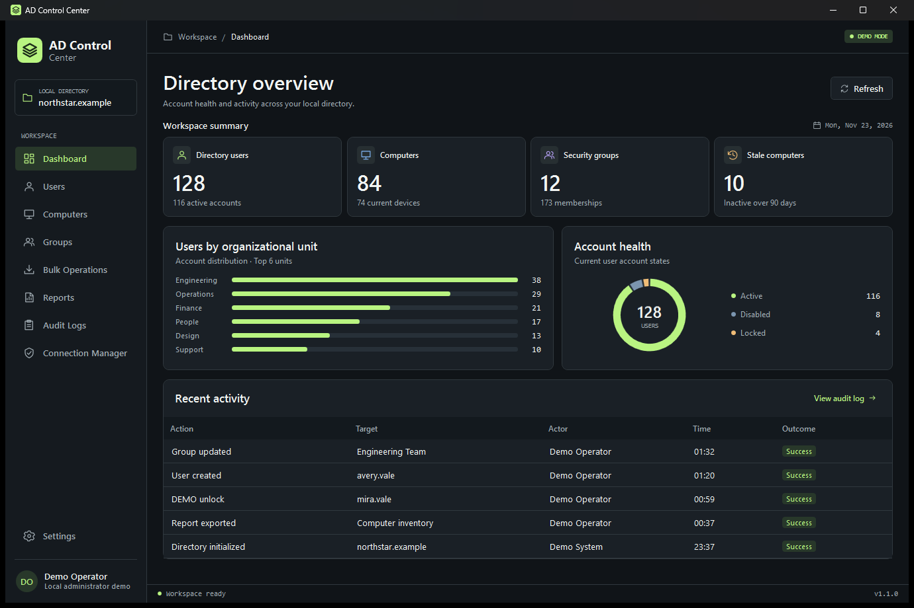

# AD Control Center

A Windows desktop portfolio project for practicing directory administration. Version 1.1 starts in **DEMO MODE** and adds an optional **LIVE READ-ONLY MODE** for Active Directory. The demo opens a fictional **northstar.example** workspace with **128 users, 84 computers, and 12 security groups**. Explore account health, review stale devices, simulate support tasks, and export the results from a standard Windows user session.



## Run on Windows 11

Build from source with the **.NET 10 SDK**. Run these PowerShell commands from the solution directory.

```powershell
dotnet restore ADControlCenter.sln
dotnet build ADControlCenter.sln -c Release --no-restore
dotnet run --project src/ADControlCenter.App -c Release --no-build
```

The first launch creates the sample directory. Subsequent launches reopen your saved workspace. Demo Mode runs offline after build or publication. The initial build restores NuGet dependencies.

To produce a self-contained Windows x64 executable with the desktop runtime included, run the following command. Launch `artifacts\win-x64\ADControlCenter.exe` as your usual Windows user.

```powershell
dotnet publish src/ADControlCenter.App -c Release -r win-x64 --self-contained true -p:PublishSingleFile=true -p:IncludeNativeLibrariesForSelfExtract=true -p:EnableCompressionInSingleFile=true -p:DebugType=None -o artifacts/win-x64
```

## Connect to a live directory

Open **Connection Manager**, enter the controller FQDN and select **LDAPS** or **Kerberos**. Enter your domain UPN and password in the application. **Test connection** verifies the bind and reads RootDSE. Re-enter the password and choose **Connect read-only** to load the dashboard. A visible mode badge identifies the active provider.

Live mode reads users, groups, computers and the OU hierarchy. Refresh queries the controller again. Directory writes are disabled. Live inventory, credentials and session events stay in memory. A confirmed CSV or HTML export is the explicit path to disk. **Disconnect** restores the existing demo workspace.

[Lab DNS, transport requirements and step-by-step acceptance checks](docs/live-lab.md) · [Changelog](CHANGELOG.md) · [GitHub release procedure](docs/release-v1.1.md)

## Explore the demo workspace

| Screen | Tasks |
| --- | --- |
| Dashboard | Inspect account counts, the six largest organizational units, account states and recent activities. Select a summary card to open its records. |
| Users | Search names, usernames and units. Create or edit accounts. Select a row for details, enable, disable, unlock or simulated password reset. |
| Computers | Combine operating system, unit and stale/current filters. A device becomes stale after more than 90 days since its last recorded activity. |
| Groups | Create a security group, edit its description and search the membership checklist. Confirm removals before saving. |
| Bulk Operations | Choose a test CSV, review all proposed users and validation messages, then confirm the complete import. |
| Reports | Export user accounts or computer inventory to CSV, JSON or HTML. The completion dialog includes the full output path. |
| Audit Logs | Search the actor, action, target, outcome or details. Sort columns, filter outcomes and open a row to read its full event. |
| Settings | Switch between dark and light themes, select an export directory, clear the demo directory or restore sample records. |

### Try an end-to-end administration task

1. Open **Users**, choose the **Locked** filter and select a fictional account. Choose **DEMO unlock** and confirm. The account leaves the locked view.
2. Open **Audit Logs** and search for the username. Open the unlock entry to inspect its timestamp, actor, target and outcome.
3. Open **Bulk Operations** and choose [the sample CSV](samples/users.csv). Review three proposed accounts, then apply the import. Previewing the same file again flags the existing usernames.
4. Export **User accounts** from **Reports**. After a fresh seed and this import, the report contains 131 users.
5. Use **Settings → Restore samples** to start again. Your preferences and audit trail are retained.


## Data and simulation boundaries

- Demo administration uses fictional records and the **Demo Operator** identity. Only Connection Manager accepts lab credentials.
- A simulated password reset records its timestamp. Demo accounts contain no password value.
- The default workspace lives at `%LOCALAPPDATA%\AD Control Center\directory.json`. The initial export folder is its sibling directory `Exports`. Reports are ordinary files and remain available after a directory reset.
- `ADCC_DEMO_HOME` can point to a different local workspace for isolated demonstrations and tests. Each workspace permits one running application instance.
- Audit entries use UTC timestamps with local-time display. Seeded example activities identify themselves in the details. The audit trail is a local learning tool and is editable by the owner of the JSON file.

## Architecture and tests

The WPF shell uses MVVM and explicit constructor injection. `IDirectoryService` defines directory operations, `IDemoWorkspace` owns workspace settings and maintenance, and `DemoDirectoryService` implements both over an atomic local JSON store. Views use typed page models and commands. Native dialogs are behind `IInteraction`. The live `ILiveReader` contract exposes reads and disposal. Its LDAP implementation uses `System.DirectoryServices.Protocols` and executes directory queries on a worker thread.

```powershell
dotnet test ADControlCenter.sln -c Release
```

To exercise the real WPF application, build Release and run the desktop smoke test from an interactive Windows session. It launches its own process, creates a temporary workspace, and cleans up that workspace after the run.

```powershell
.\scripts\Test-Desktop.ps1
```

- [Architecture and storage design](docs/architecture.md)
- [Import format, validation and recovery](docs/operations.md)
- [Testing and screenshot instructions](docs/testing.md)
- [MIT license](LICENSE)
